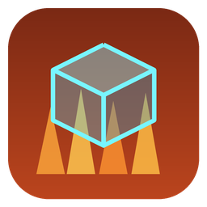
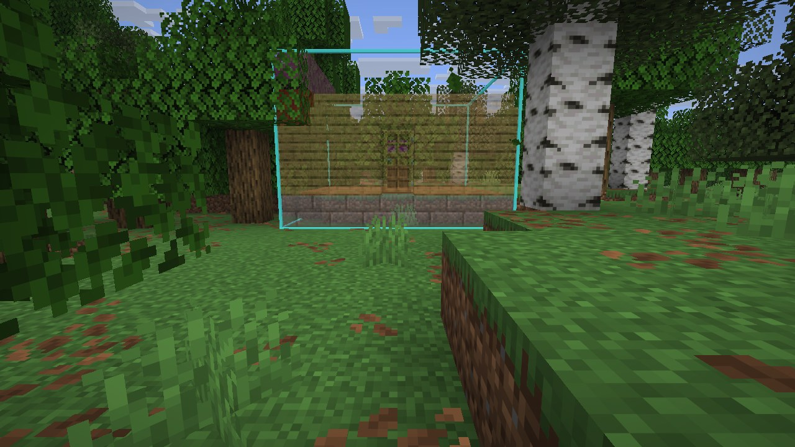
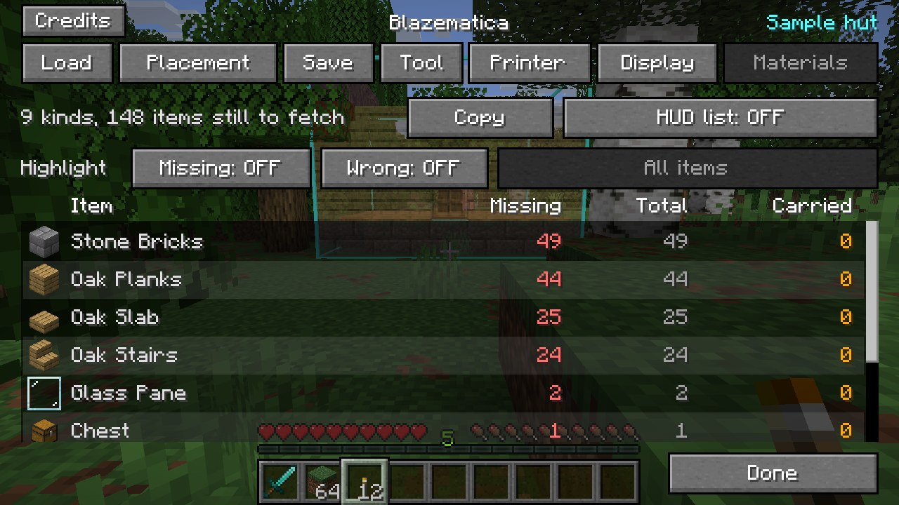

# Blazematica

A native Rust schematic mod for Horizon’s Minecraft Java Edition 26.3 client. Open the mod with **M** or start with `/lm help` in a world.

- Load `.litematic` versions 1–7, Sponge `.schem`, legacy `.schematic`, and vanilla structure `.nbt`.
- Preview a build as ghost blocks, move or rotate the placement, mirror it, and show individual layers along X, Y, or Z.
- Compare your build to its schematic and view the required materials. Keep multiple placements and restore them per world and dimension.
- Capture an area and export its blocks and states as a `.litematic`. Easy Place and the optional printer are available from the mod menu.

 

### Compared with Horizonmatica

Blazematica started from keksi2k's [Horizonmatica](https://github.com/keksi2k/horizonmatica) and keeps its history. On top of it:

- Layers can be sliced along X and Z, not only Y (`/lm layer axis x`).
- Schematic text is read as Java writes it (modified UTF-8), so names with special characters load correctly.
- File reading is bounded (size and decompression caps), and uncompressed `.nbt` files load too.
- Built for the current Horizon Nightly.

Its id and commands (`/blazematica`, `/lm`) differ from Horizonmatica's (`/horizonmatica`, `/hm`), so they don't clash. Both patch the game, though, so they can only be built together when both are made for the same Nightly: right now Horizonmatica's listed release needs Nightly 0a875da and Blazematica f1bb66f.

## Install

1. Download the `blazematica-….hmod` file from the [latest release](https://github.com/selfmonoraque5/blazematica/releases/latest).
2. Put it in the `horizon-native-mods` folder of your game folder, not in `mods`. On Windows that is
   `%APPDATA%\horizon\horizon-native-mods`.
3. In the launcher, open the Mods page and click **Build**. When it says **Up to date**, play.

Made for Horizon **Nightly 2026-11-22 · f1bb66f**. It uses the game's own renderer and block placement where the mod
API has nothing for them (`[[native.module]]` and `[[native.mixin]]` rows in `hmod/horizon-mod.toml`), so it builds
only on that exact Nightly.

## Building

Package the mod with `cargo horizon-mod build` in `hmod/` (or `python tools/package.py --launcher <path-to-horizon-launcher>`).
Run `cargo test --workspace` for the portable Rust tests and `cargo run -p sample-hut -- sample_hut.litematic` for a
small test schematic.

## Use it in a world

1. Run `/lm folder` to locate the instance’s `schematics/` directory and put your schematic there.
2. Press **M** and choose the file under **Load**, or run `/lm load <name>`.
3. Use the **Placement**, **Display**, and **Materials** tabs to position the ghost, configure its appearance, and check your build. `/lm layer axis x` switches to X-axis slicing.
4. To export, set two corners in **Save** or with `/lm pos1` and `/lm pos2`. Run `/lm save <name>` to write the selected area.

See the [in-game guide](docs/wiki/Home.md), [command reference](docs/wiki/Commands.md), and [port plan](PORTING.md). Imports are limited to 128 MiB on disk and 512 MiB of decoded NBT. Sponge, vanilla structure, and legacy schematic imports have separate cell limits of 64 Mi, 16 Mi, and 2 Mi respectively. The current area capture writes a single region of block states. Saving entity data, editing individual imported subregions, and compatibility with the Java Easy Place server protocol remain open.

## Credits and license

Blazematica is maintained by [selfmonoraque5](https://github.com/selfmonoraque5). It was ported by [TheApple05](https://github.com/TheApple05) from [Horizonmatica by keksi2k](https://github.com/keksi2k/horizonmatica), which it builds on. [Litematica by masa and Sakura-Ryoko](https://github.com/sakura-ryoko/litematica) is the reference for schematics and workflows. The printer is based on the behavior of [Litematica Printer by aleksilassila](https://github.com/aleksilassila/litematica-printer). Horizon provides the native loader, world access, renderer, and block-state data fixer. The Rust implementation is distributed under the [MIT license](LICENSE). It is not made or endorsed by the Litematica, Litematica Printer or Horizonmatica authors.
